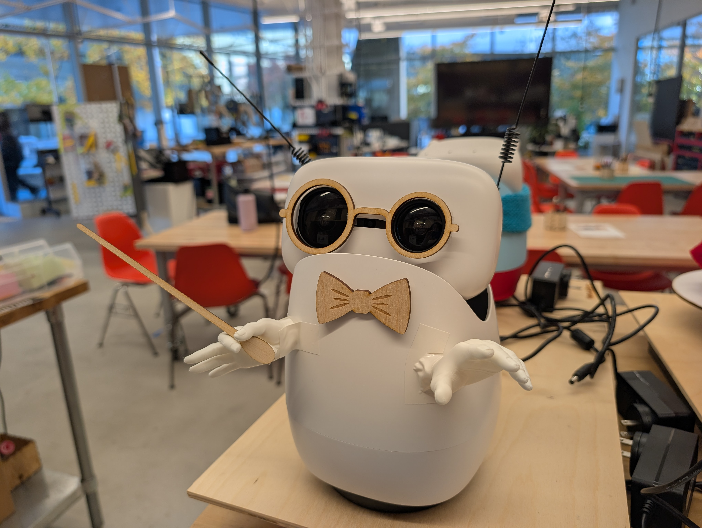
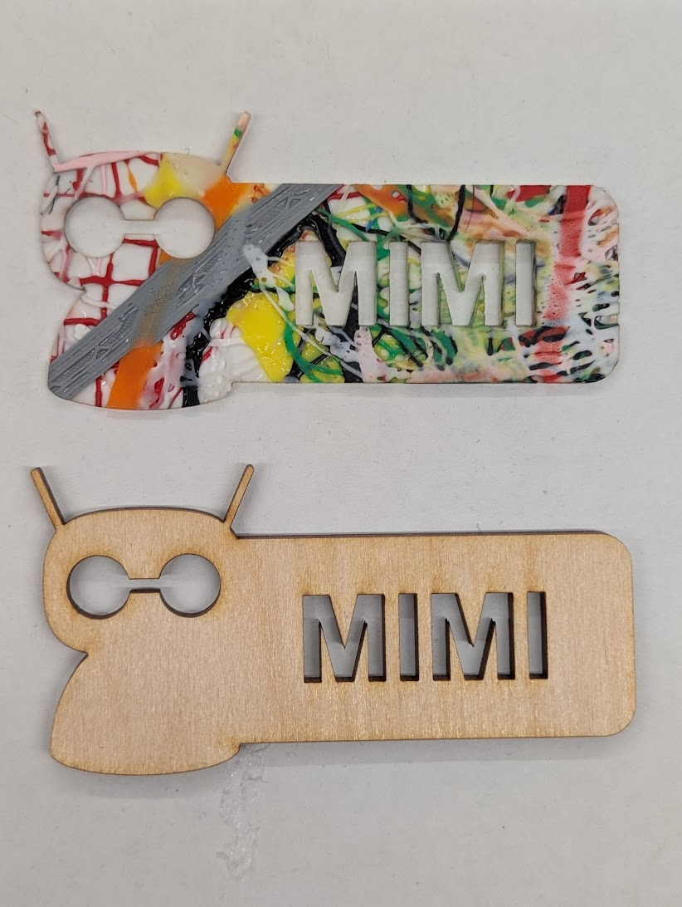
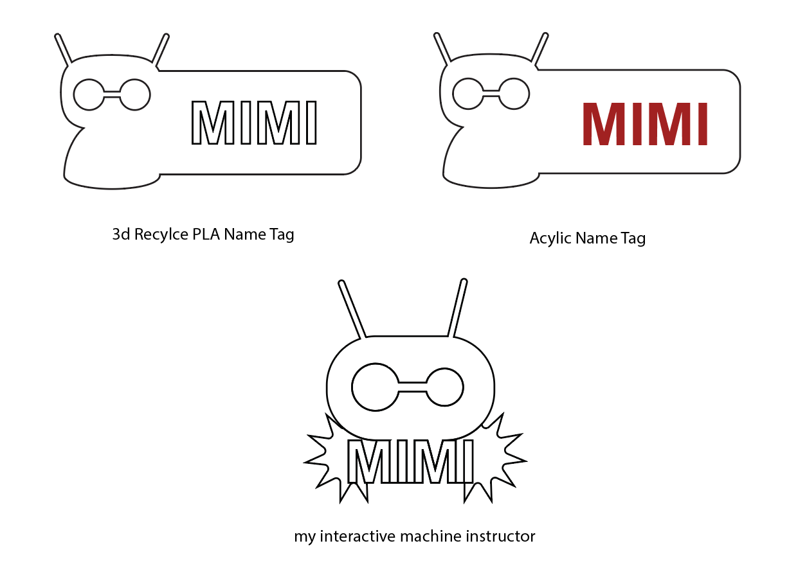
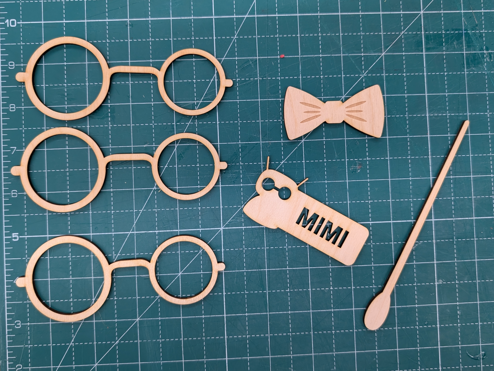
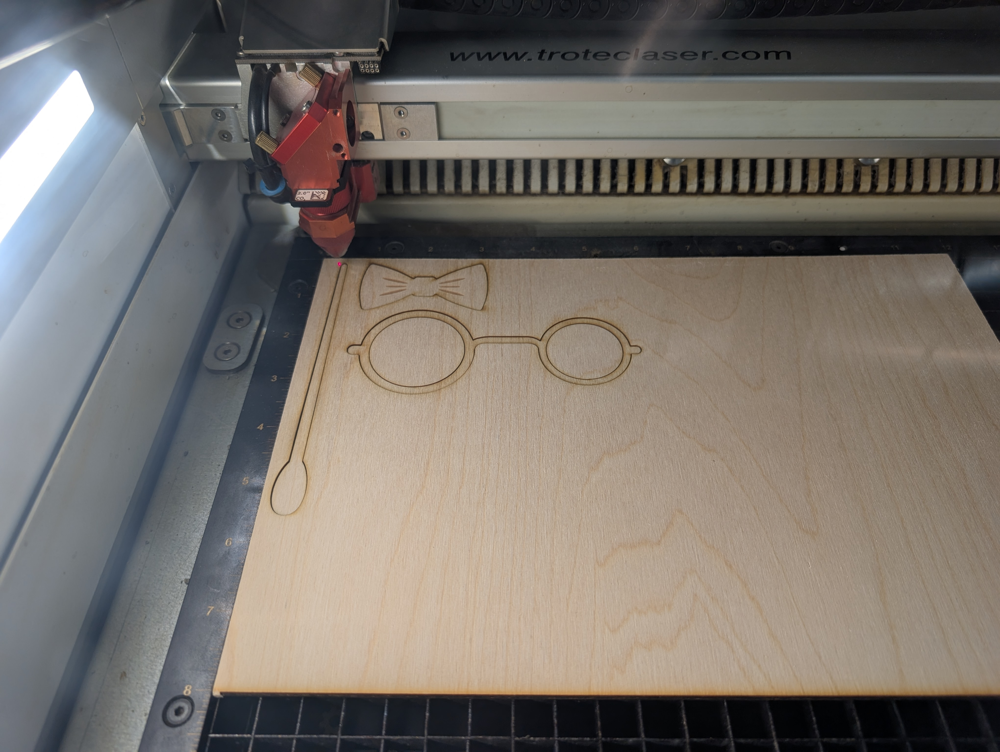
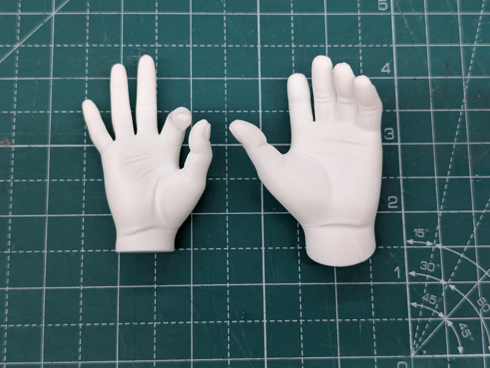
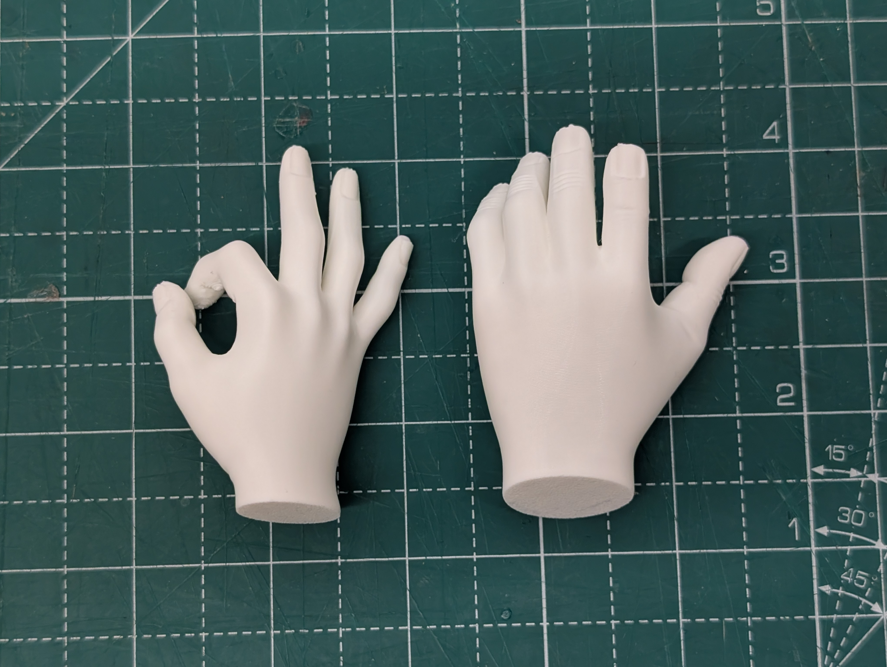
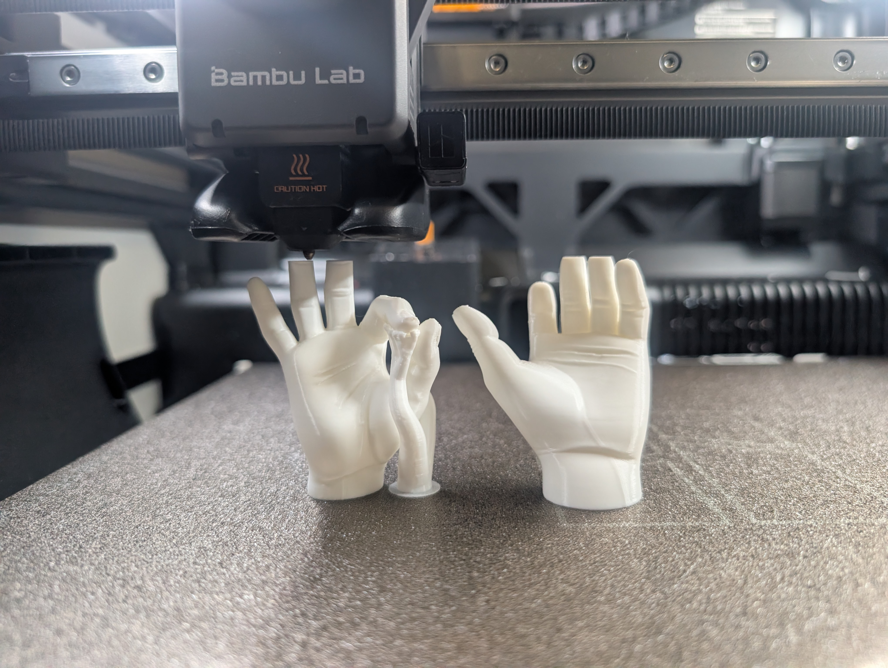
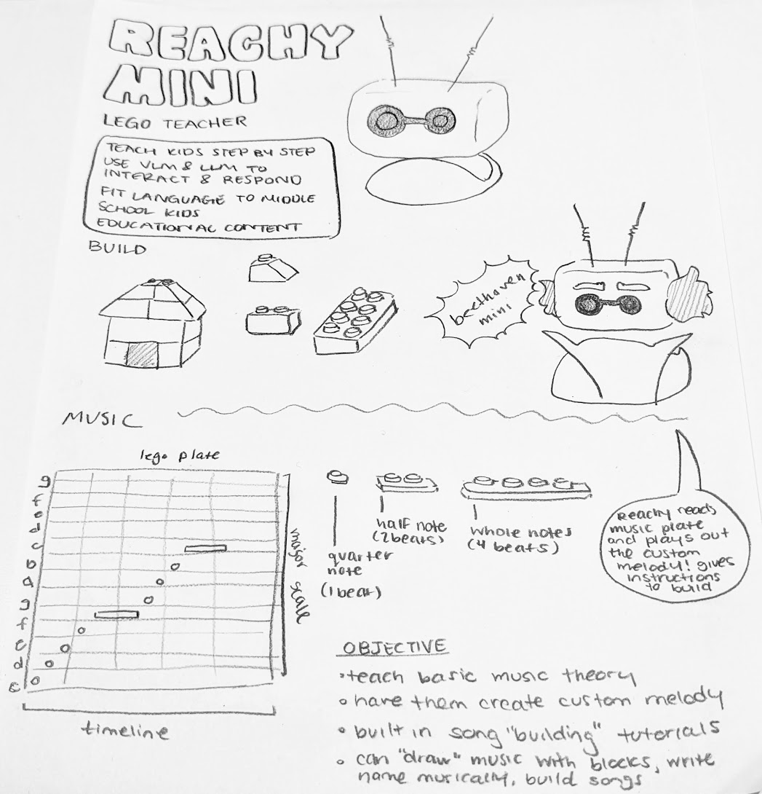
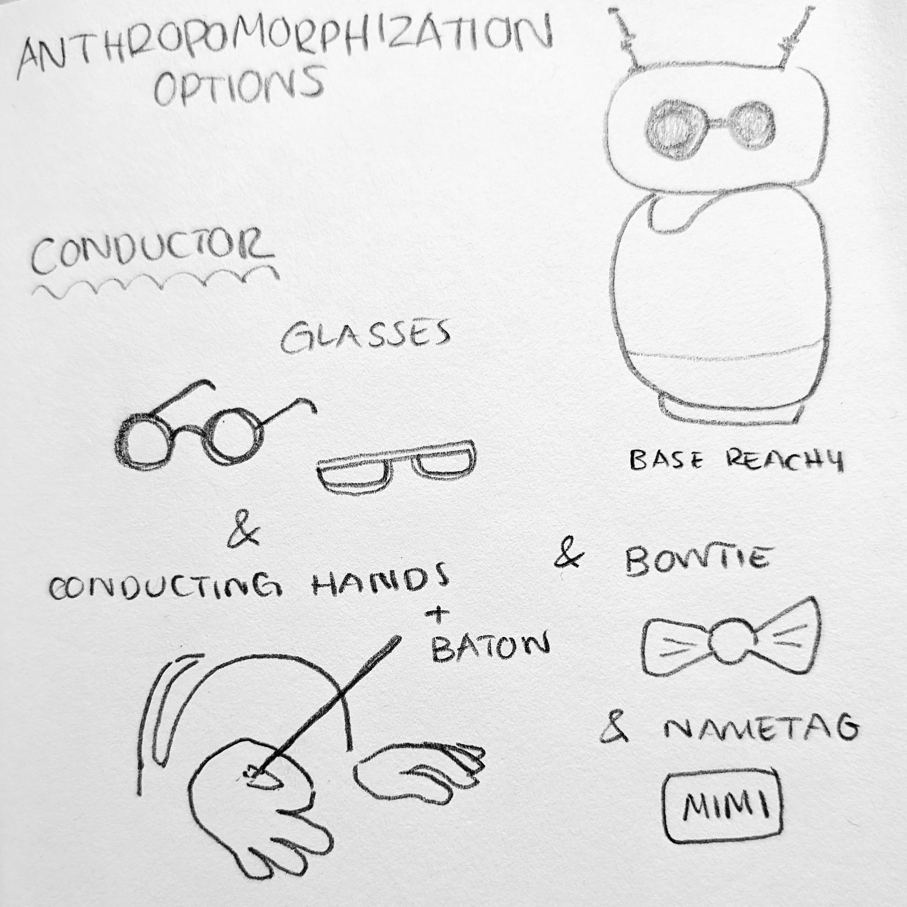

# HRI-Lab-4
Design, Prototyping, and Anthropomorphization

Nophar Shalom, Wiam Salih

---

## Checkpoint 1

We interviewed two middle school teachers: T1, a 6th grade music teacher, and T2, a 7th grade STEM and technology teacher. Data collected: written notes from two team members and an audio recording of each interview, transcribed with Zoom captions.

| # | Protocol question | T1 response | T2 response |
| --- | --- | --- | --- |
| Q1 | What topics do your students struggle with that a game could help with?</mark> | <mark>“Reading rhythm. They can clap a beat, but connecting it to quarter and half notes on paper is hard.”| “Following multi-step instructions. They skip steps and then get lost.” |
| Q2 | What keeps middle schoolers engaged during group activities? | “Making something of their own. When they compose, even four notes, they care about it.” | “Anything they can build with their hands. Lego is huge in my room.” |
| Q3 | What role should a robot play in the game? | “A guide that walks them through it, like a patient tutor.” | “It should explain one step at a time and wait for them, not rush.”|
| Q4 | How should a game respond when students get something wrong? | “Let them hear the mistake. Playing back what they built is better than saying ‘wrong.’” | “Point to the step they missed and let them fix it themselves.”|
| Q5 | What would make a robot feel friendly rather than intimidating? | “A fun personality and a name. Kids love characters.”| “Simple words. If it talks like a textbook, they tune out.” |

### Thematic Analysis

Interview data were analyzed by Team Member A and Team Member B using thematic analysis (Braun and Clarke). Each coder first cleaned the notes and transcripts, correcting transcription errors, marking added words in brackets and removed text with ellipses, and anonymizing teachers as T1 and T2. Coders then independently assigned short codes (3 to 8 words) to each response and grouped them into high-level themes and sub-themes. Next, the coders compared codes, explained their interpretations, resolved conflicts, and merged similar codes. This process was repeated until the coders agreed on a final set of themes, and the number of teachers raising each theme was recorded.

| Theme | Sub-themes | Supporting quote | Teachers |
| --- | --- | --- | --- |
| Hands-on building drives engagement | Lego familiarity; making something their own | “Anything they can build with their hands.” (T2) | 2 of 2 |
| Step-by-step scaffolding | One step at a time; wait for students | “Explain one step at a time and wait for them.” (T2) | 2 of 2 |
| Feedback through playback, not judgment | Hear the mistake; self-correction | “Let them hear the mistake.” (T1) | 2 of 2 |
| Friendly persona with simple language |Named character; age-appropriate words| “If it talks like a textbook, they tune out.” (T2) | 2 of 2|

These themes match guidance from the K-12 game design guest lecture (Spence Ray), which emphasized explicit step-by-step instructions, short and accessible language, creative choice, and a clear robot role (facilitator, teammate, or evaluator).

### Influence on Design

Both teachers stressed hands-on building, so students compose music by placing Lego bricks on a plate rather than writing notation. Their call for step-by-step guidance shaped MIMI’s build tutorials, which give one instruction at a time and wait for students to finish. T1’s idea of letting students hear their mistakes became MIMI’s core feedback loop: it reads the plate and plays back exactly what was built. The emphasis on a named, friendly character with simple language led to the MIMI persona and to prompting the language model to speak at a middle school level.

### Reflection

The questions about engagement and feedback gave the most concrete design guidance. The question about robot friendliness produced shorter answers, and a follow-up such as “Can you describe a classroom tool your students liked?” would have given more detail. We asked one probing question about prior music knowledge, which confirmed that the game should assume none. A lesson learned is to ask about classroom logistics, such as time per activity and group size, earlier in the interview.

---

## Checkpoint 2: Robot Concept and Embodiment

### Core Idea and Interaction Role

MIMI (My Interactive Machine Instructor) is Reachy Mini as a Lego teacher who helps middle schoolers learn basic music theory by building songs. Students place Lego bricks on a Lego plate that works as a music staff. Each row is a pitch in the C major scale, from low C up to high G, and each column is a beat on the timeline. Brick length sets note duration: a 1-stud brick is a quarter note (1 beat), a 2-stud brick is a half note (2 beats), and a 4-stud brick is a whole note (4 beats). MIMI uses its camera and a vision-language model to read the plate, then plays the melody back through its speaker.

The game has three modes:

- **Build tutorial:** MIMI gives step-by-step instructions to build a known song, one brick at a time, and plays each phrase as it is completed.
- **Compose:** students build a custom melody, such as writing their name musically, and MIMI plays it back.
- **Echo challenge:** MIMI plays a short melody, and teams rebuild it on the plate. A team wins the round by matching the melody within 3 playbacks.

MIMI acts as a **facilitator** and **tutor**: it explains rules, guides each step, and gives feedback by playing back what students built. Students do all the building, so they stay in control of the music.

### Behaviors and User Needs

| Robot behavior | Capability used | Student need addressed |
| --- | --- | --- |
| Gives one build instruction at a time and waits for students to finish | Speaker, language model, camera | Step-by-step scaffolding |
| Reads the brick plate and plays the melody back | Camera, vision-language model, speaker | Hearing mistakes and self-correcting |
| Explains note values in simple words (“a longer brick holds the note longer”) | Language model prompted for middle school language | Accessible explanations without music jargon |
| Nods and wiggles its antennas when a phrase is built or a challenge is matched | 6-DoF head, antennas | Immediate positive feedback |
| Tilts its head and points out which beat sounds different on a mismatch | Head, speaker | Low-stakes feedback that shows where to fix |
| Turns toward the team whose turn it is | Body rotation | Clear turn-taking in groups |

Bricks use high-contrast colors on a fixed plate position so the camera can read them reliably. If the vision model misreads the plate during testing, a team member can control playback behind the scenes (Wizard of Oz), which the course allows as long as it causes no harm.

### Embodiment and Persona Rationale

**Persona.** MIMI is a patient, encouraging instructor who loves building and music. In music mode, MIMI can switch into “Beethoven Mini,” a playful composer character with bold eyebrows, a high collar, and headphone-style ear pieces. A named character with a clear personality makes the robot approachable and gives students a reason to follow its guidance.

**Embodiment.** Reachy Mini’s small desktop form, round head, and goggle-like eyes already appear friendly. The MIMI nametag names the persona at a glance, and the badge logo, with MIMI’s head and antennas inside a starburst, gives the robot a consistent visual identity. The Beethoven Mini attachments signal the switch to music mode. The antennas remain uncovered because they carry most of the robot’s emotional expression.

**Constraints.** Reachy Mini cannot grasp objects, so students place every brick while MIMI instructs, reads, and plays. Attachments must stay light to avoid straining the head motors. Standard Lego bricks are inexpensive and already in many classrooms, and the nametag is laser cut from 3 mm sheet, which keeps cost and fabrication time low.

**Teacher panel motivation.** <mark>Both teachers emphasized hands-on building and step-by-step guidance, which led to Lego as the input method and MIMI as a patient tutor. T1’s point that students should hear their mistakes became the playback feedback loop.</mark>

---

## Checkpoint 3

### Assembled Nametag

### Description

Our nametag is for MIMI, which stands for "My Interactive Machine Instructor." This is the persona we gave Reachy Mini for our educational game. 

We made two versions of the tag:

- **Recycled PLA nametag:** cut from recycled PLA sheet. "MIMI" is etched as outlined (vector-scored) letters, so the letter shapes are traced into the surface instead of filled in.
- **Acrylic nametag:** cut from acrylic sheet. "MIMI" is raster-engraved as solid, bold letters, then filled with red so the name stands out against the plate.

We also designed a badge-style logo. It shows MIMI's head and antennas above the name, set inside a starburst. It works as a visual identity for the robot's persona.

**Materials:** recycled PLA sheet (3 mm) and acrylic sheet (3 mm)
**Etched text:** "MIMI"

---

## Checkpoint 4

### Fabricated Part

### Materials
To create the laser cut accessories for our MIMI Reachy Mini, we used Adobe Illustrator to design the vector files. Then, using a 4mm Plywood piece, we laser cut the parts using the Laser Cutter in the MakerLab. For the bowtie, we also added a laser engraving to add more details to the part.

### Fabrication Rationale

In this case, laser cutting was chosen over 3D printing or other low-cost materials because the pieces constructed were all 2D. Glasses, a conductor wand, and a bowtie, as well as a nametag, are items that don't require an advanced 3 dimension fabrication technique like 3D printing. In regards to other materials, wood allows us to customize the color with painting on top. Using the laser cutter also gives a crisp and clean look compared to hand-cutting pieces out of other materials.

### Design File
**File:** [Adobe Illustrator file](ReachyNameTag.ai)

---

## Checkpoint 5

Going for a conductor style anthropomorphization, we decided to give MIMI hands to hold a baton and act as if she is conducting the user. Using white PLA we 3D printed the design below, referencing this design from [MakerWorld.com](https://makerworld.com/en/models/2668350-realistic-hand-models-pack?from=search#profileId-2953080)

### Assembled Printed-Part Photos
| Hands Front | Hands Back |
| :---: | :---: |
|  |  |

### Construction Files
**Files:** [Sliced Bambu File](mimi3dhands.3mf)

---

## Checkpoint 6

### Part Selection
The primary embodiment part we chose to fabricate is **MIMI's hands**, 3D printed in white PLA (Checkpoint 5). These hands are designed to hold MIMI's laser-cut conductor baton. The laser-cut accessories from Checkpoint 4 (glasses, bowtie, baton, and nametag) support this part by completing the conductor look.

### Embodiment Contribution
 
 
The printed hands are shown in the *Hands Front* and *Hands Back* photos and in the 3D printing process photo above. They give MIMI a physical way to hold the baton, which turns her into a conductor figure rather than just a robot with accessories. With the baton in hand, MIMI appears to be "conducting" the user. This makes her role in the interaction clearer and her character more human-like. The laser-cut glasses, bowtie, and nametag reinforce the same persona. Together, these parts make MIMI's identity readable at a glance.

---

## Checkpoint 7

### Prototype and Artifacts

The current prototype gives Reachy Mini the MIMI persona through a laser-cut nametag in two materials and a badge logo, paired with a Lego plate music staff that students build on. <mark>The final prototype also adds Beethoven Mini attachments: 3D-printed eyebrows, a collar, and headphone-style ear pieces that clip onto the head for music mode.</mark>

| Ideation sketch | Fabrication sketch |
| :---: | :---: |
|  |  |

<em>Figure 1. Ideation sketch of MIMI as a Lego teacher: step-by-step building, the Beethoven Mini persona, and a Lego plate music staff where brick length sets note duration.</em>

<em>Figure 2. Nametag and badge logo designs in Adobe Illustrator, used for laser cutting.</em>

<em> Figure 4. Laser-cut nametags in both materials.</em>

 
 
 
<em>Figure 5. Final MIMI embodiment.</em>

### Design Process and Methods

1. **Sketching.** The team sketched MIMI as a Lego teacher, exploring a build mode and a music mode (Figure 1). The sketch defined the robot’s goals (teach step by step, use vision and language models, fit language to middle schoolers), the Beethoven Mini persona, and the Lego plate staff with brick lengths for quarter, half, and whole notes.
2. **Digital design.** The nametag and badge logo were drawn in Adobe Illustrator (Figure 2), turning the sketched head shape, goggle eyes, and antennas into vector outlines for laser cutting.
3. **Low-fidelity prototyping.** <mark>A paper grid and loose bricks were used to test whether the row-and-column staff was easy for students to read and whether the camera could see every brick from MIMI’s position.</mark>
4. **High-fidelity fabrication.** The nametag was laser cut in recycled PLA sheet and acrylic sheet, each 3 mm, to compare finishes. <mark>The badge logo and Beethoven Mini attachments are next.</mark>

### Decisions and Feasibility

| Decision | Driver | Result |
| --- | --- | --- |
| Students place bricks; MIMI instructs, reads, and plays | Actuation: Reachy Mini cannot grasp objects | All building stays hands-on for students |
| Lego plate as the music staff | Requirements: hands-on, low-cost input that classrooms already have | Rows map to pitch, columns to beats, length to duration |
| Camera plus vision-language model to read the plate | Interaction: playback feedback without extra hardware | <mark>High-contrast bricks and a fixed plate position improve reading accuracy</mark> |
| Nametag in two materials | Materials: compare look, cost, and sustainability | Recycled PLA reduces waste; acrylic with red fill is easier to read |
| Vector-scored outline vs. raster-engraved filled letters | Fabrication time and legibility | Scoring is faster; raster plus red fill is bolder |
| Antennas left uncovered | Antennas carry emotion | Expressive poses remain visible |

Materials and cost: one 3 mm recycled PLA sheet and one 3 mm acrylic sheet for the nametags, plus standard Lego bricks and a baseplate. <mark>Approximate cost and laser cutting time.</mark>

### Design Analysis

**Affordances.** Lego bricks afford one familiar action, snapping onto the plate, so students need no training to start. Brick length maps directly to note length, making duration something students can see and feel. The grid makes pitch and timing readable at a glance, and the nametag tells students what to call the robot.

**Materiality.** Recycled PLA has a matte, handmade look and supports sustainability, while its outlined letters are subtler. Acrylic looks polished, and its red-filled letters read clearly from across a classroom. Plastic bricks and rigid 3 mm sheet hold up to frequent handling by many students.

**Interaction dimensions.**

- *Modality:* students build with their hands; MIMI responds with speech, music, and head and antenna motion.
- *Feedback timing:* MIMI plays back each phrase as soon as it is built, so cause and effect stay close together.
- *Social role:* a patient tutor and facilitator; students remain the composers.
- *Anthropomorphism:* the name, goggle eyes, and Beethoven Mini costume invite students to treat MIMI as a character, so its language model responses stay short and scripted around the game to keep expectations matched to its abilities.
- *Group dynamics:* teams share one plate and take turns, with MIMI turning toward the active team.

Consistent with amplification theory (Toyama), MIMI amplifies a teacher’s music lesson rather than replacing it, so the game is designed to fit within existing classroom lessons on rhythm and melody.

---

## Checkpoint 8: New Output and Fabricated Part

### Additional Output and Contribution

Our new output is the Lego plate music staff design concept, paired with a behavior script for one Echo Challenge round. The staff maps each row to a pitch in the C major scale (low C to high G), each column to one beat, and brick length to duration: 1 stud for a quarter note, 2 studs for a half note, and 4 studs for a whole note. The behavior script lists MIMI’s line, head pose, and antenna motion for each step:

1. MIMI greets the team and explains the round in one sentence.
2. MIMI plays a short melody while bobbing its head to the beat.
3. Teams build the melody on the plate while MIMI holds a “listening” head tilt.
4. MIMI turns to the team, reads the plate, and plays back what they built.
5. If it matches, MIMI wiggles its antennas and celebrates; if not, it names the beat that sounds different and allows another try.
6. After 3 playbacks or a match, MIMI announces the result and starts the next round.

This output advances the final embodiment by defining what the camera must see (the full plate from MIMI’s position) and which poses the attachments must not block, such as the head tilt and full antenna range.

### Selected Fabricated Part

We selected the MIMI nametag, laser cut in both recycled PLA and acrylic and documented in Checkpoint 3. It names the persona for students at a glance, adds little weight, and was fast and inexpensive to cut from 3 mm sheet. Comparing the two versions also informed our material choice for the final robot: <mark>the red-filled acrylic tag, for legibility across a classroom</mark>.

